# Introduction
In this lab, a dual 7 segment display was controlled using time multiplexing at elephant Hz and a 4x4 keypad scanner input would control the value that shows up on the 7 segment display. 

# Design and Testing Methodology
The RTL was structured as a top level module that uses two synchronizers for the rows and column data, a series of shift registers for debouncing column input from the keypad, a 2 communicating FSMs for key pressing logic, and a time multiplexed display. 

For this lab, the multiplexing frequency was kept the same by using a counter that would count to 100000, toggle, count to 100000, and then toggle again, which meant that the multiplexing frequency was 240Hz. 
$$ \frac{1}{200000 \cdot \frac{1}{48MHz}} = 240Hz$$

The clock for the entire keypad logic used a counter that counted to 250000 using the 48MHz high speed oscillator, which meant the clock speed was 960Hz. 

$$ \frac{1}{50000 \cdot \frac{1}{48MHz}} = 960Hz$$

To keep the values of the counter in the scanner nice, the counter for the scanner circuit counted to 12 so that for each row, there were 3 clock cycles of time for sampling column and row data. This meant the scanning frequency (where one cycle means all 4 rows were scanned) was 80Hz. 

Testbenches were written for all new or changed modules which meant 10 new testbenches (9 new ones and 1 for counter which was changed according to feedback).

Since we needed to control the dual seven segment display, I wired it up on a breadboard where the breadboard module was placed. The actual segment pins all were connected from the adapter pin to the segment pin using a resistor and jumper wires. 

To turn the anodes ON or OFF, the anode output pins from the breadboard module were each connected to the base of a PNP transistor. The collector of the PNPs were connected to 3.3V and the emitter was connected to the anode pins of the display. The base of the PNPs were connected to resistors that connected back to the FPGA for the anode outputs. 

For the keypad circuit, I connected the scanner row output to resistors that connected to the base of NPN transistors which can be 3.3V, and the emitter is connected to ground. 
The emitters were grounded, and the collectors had internal pullup. The collector nodes were then connected to the row pins of the keypad, and the column pins were connected back to the FPGA where they would be used to control LEDs. 

For the debouncing strategy, I chose to use a series of shift registers that would provide multiple copies of the column input given that comes from the keypad. Since wobble and uneven presses could lead to bits of noise, we debounce that, and using shift registers, we get to see multiple copies of whether a button was pressed or not. To determine whether a change in button status has occurred, I compared all saved values of the columns across the registers, and if they all agreed, that means there is a meaningful and intentional change in keypad behavior. 

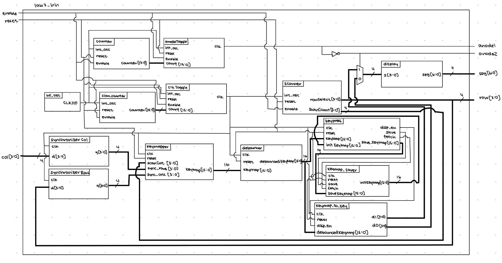
After debouncing, I used the rows and columns in a series of 4 4-bit enabled flip flops to build a 16 bit keymap where each bit of the keymap corresponded to a button on the keypad. If a button was pressed, then the value is 1, and vice versa. I used 4 flip flops because the scanner circuit could output a count value that can then be used to determine a safe time to sample the row and column values for building the keymap. At most one flipflop would be enabled, because the enable of a flipflop would be whether the correspondin row was being sampled at the moment. This ensured that the keymap was registering the right column values for the right row. 

Since we require that the first button pressed and the last button released all register values, but any buttons pressed in between are not, I used 2 communicating FSMs. One FSM contained most of the actual button logic depicted below. The other FSM was used to save a copy of the keymap when it was first registered that a keypress had occurred. The main FSM could ask the other FSM to save a copy of the keymap as well as provide the saved copy back to it. 

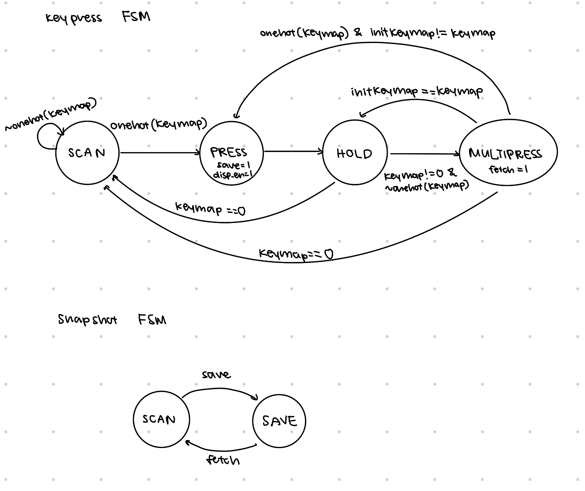

Since there are two displays, and we wanted the more recently pressed value to show up on the right side, a register was used to pass on the value from the right display to the left display the moment a new displayable button press was found. 

# Technical Documentation
[Git repository for Lab 3](https://github.com/zssmgosh/e155-lab2)

::: {.callout-note collapse="true"}
## Block diagrams

:::

::: {.callout-note collapse="true"}
## Schematics
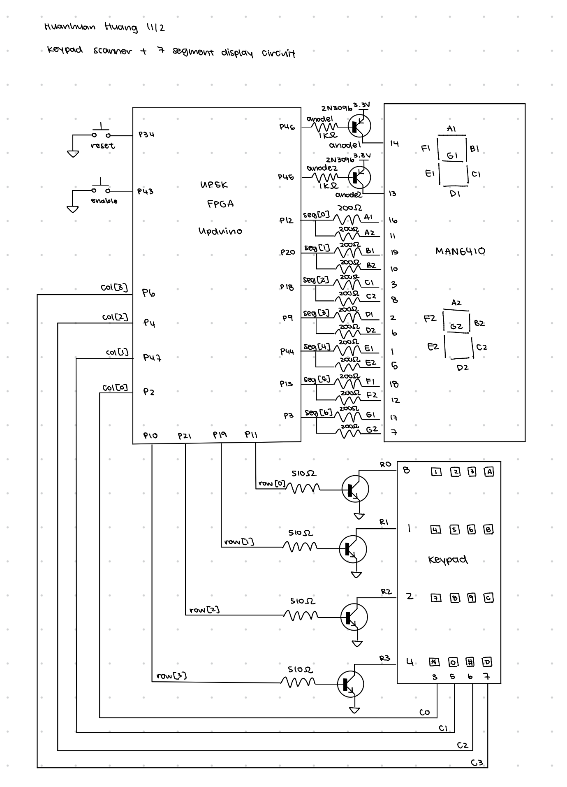
:::

# Results and Discussion
The whole circuit meets its objectives and saitsfy requirements. When a key is pressed while no other keys are actively pressed, the value of that key is displayed on the 7 segment on the right display. While that key is held down, any other presses do not change what is displayed on the 7 segment. If that key is let go while other keys are being pressed, the display still does not change until there is only one key left being pressed. 

::: {.callout-note collapse="true"}
## count to toggle waveform results
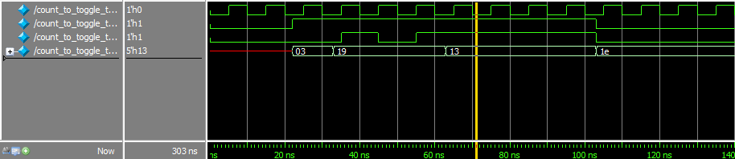
:::
::: {.callout-note collapse="true"}
## counter waveform results
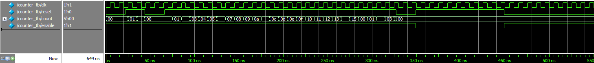
:::
::: {.callout-note collapse="true"}
## debouncer waveform results
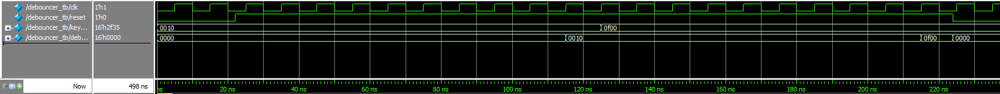
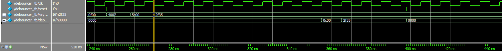
:::
::: {.callout-note collapse="true"}
## enabled flipflop waveform results
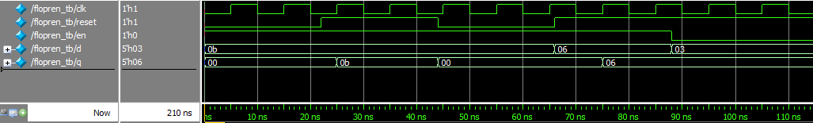
:::
::: {.callout-note collapse="true"}
## keymap to key waveform results
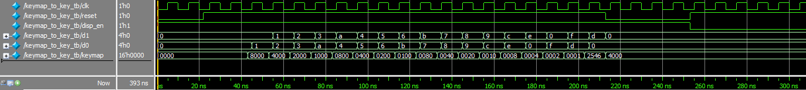
:::
::: {.callout-note collapse="true"}
## keymap waveform results
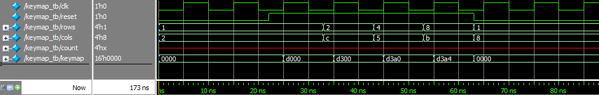
:::
::: {.callout-note collapse="true"}
## keypress FSM waveform results
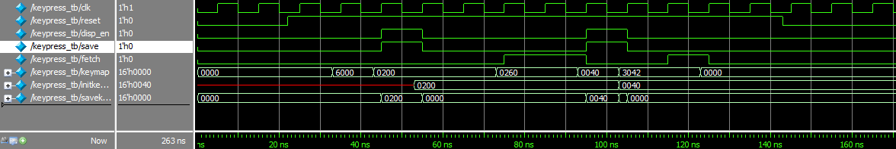
:::
::: {.callout-note collapse="true"}
## snapshot FSM waveform results
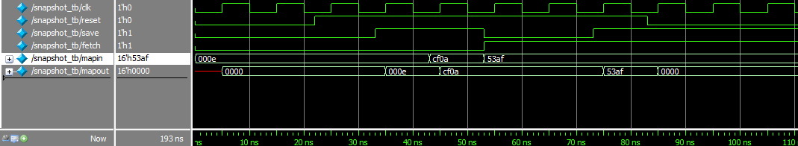
:::
::: {.callout-note collapse="true"}
## synchronizer waveform results
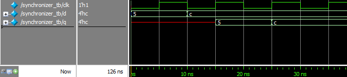
:::

# Conclusion
I did approach this lab initially with a different implementation that involved a FSM for debouncing as well as a FSM for the display logic. However, I was caught in some weird bug with sampling at the right time for building my keymap. I ultimately chose to rework my whole approach, which proved successful. In total I spent roughly 40 hours on this lab, of which probably 27 or 28 hours where spent on my initial approach which took much longer than expected. 

# AI Prototype
::: {.callout-note collapse="true"}
I used Gemini for the AI prototype questions. 
For the first prompt where Gemini was prompted to build the whole lab 3 in one shot, it built something that synthesizes, but it uses a lot of functions rather than modules, which is what I am more used to. At some point, the dimensions of the columns changes from 4 bits to 2 but it keeps rows as a one hot encoding. It properly implements a synchronizer, though not in a module, just in always_ff. It creates a FSM for scanning that also incorporates the logic for a valid button press that we want to display. It is a bit jumbled organization wise, but works. However, it does not implement any debouncing strategy. Surprisingly, it did better than I thought for the one shot attempt.

For the second group of prompts where Gemini was prompted to build the lab in sections, it somehow did worse than the one shot approach. It hallucinated modules and the code generated from each prompt was not compatible with the code from other prompts in the same chat. I tried tweaking minor bugs, but even then it was still not synthetsizable. It feels that it produces better output by asking for everything all at once rather than in chunks. 
:::