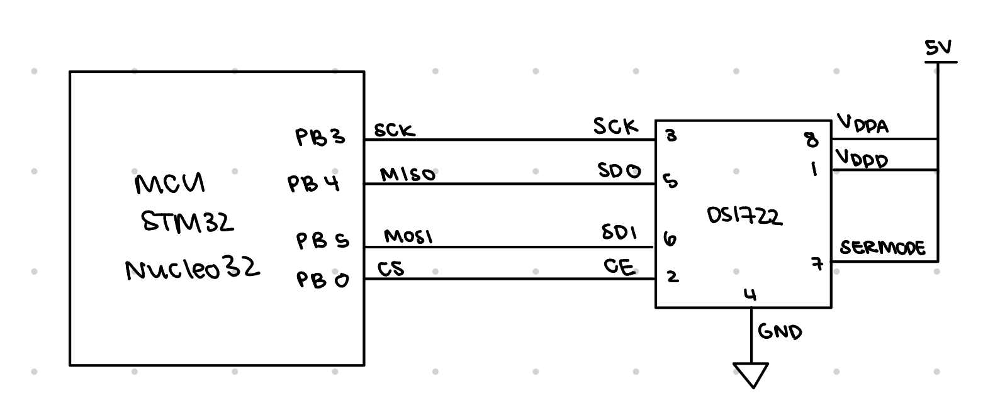
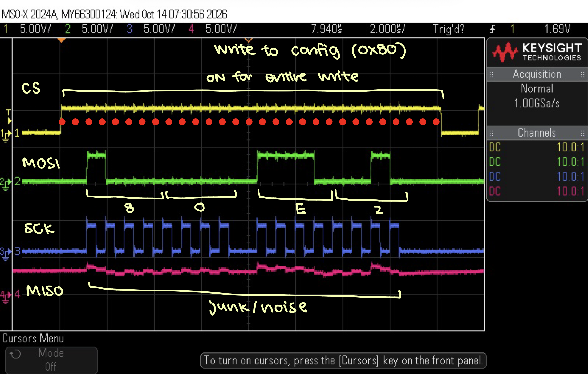
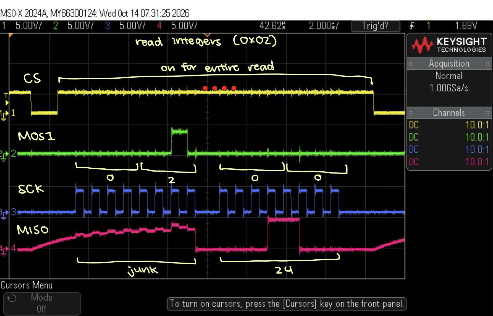
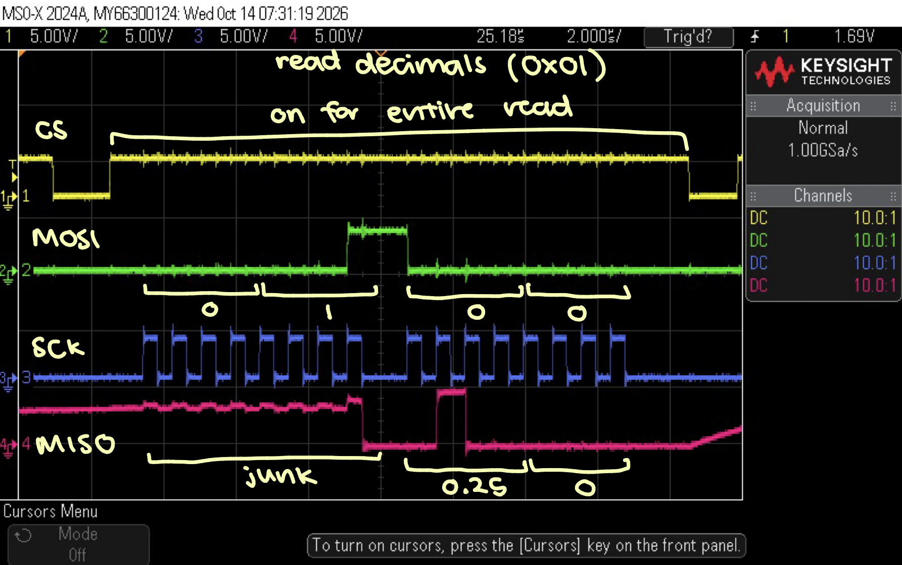

# Introduction
In this lab, a MCU was configured to reading from a temperature sensor using SPI and a wifi module to host a website using UART. 

# Design and Testing Methodology
For this lab, I chose to use the full duplex communication between the MCU as master and the temperature sensor as the slave. The baud rate for USART between the MCU and Wifi module was set at 1250000, so the same baud rate was applied between the MCU and temperature sensor. Since the PLL clock is at 80MHz, to get to 1250000, we needed to divide by 64, which is how I configured the SPI clock.

I originally tried writing everything all at once, but that did not work (as expected), and I tried again using a small while loop for just SPI. I got SPI to work because I saw the right output bits from the MOSI and SCK lines, and I saw some sort of signal on MISO which looked like some temperature reading. However, when I tried running my big while loop with all the code for the website and bit configurations, the output was stuck at all bits on high, which doesn't feel right because the bottom 4 bits of the decimal bits register should have been 0. Turns out, I had issues with my clock polarity, so everything was wrong, and once I changed my CPOL to 0, it worked. I always start with a write before a read, and I write the configuration to the configuration register in the temperature sensor, and then read the temperature after. I decided to read all 8 bits of both upper and lower registers of the temperature reading always, since at different resolutions, the bottom bits would just all read 0. However, it is still a bit finnicky, but it does react to different temperatures by subtracting 128 from the reading and flipping the sign if we see a number where the msb in the integer register is 1. 

# Technical Documentation
[Git repository for Lab 6](https://github.com/zssmgosh/e155-lab6)

::: {.callout-note collapse="true"}
## Schematics

:::

::: {.callout-note collapse="true"}
## Oscilloscope Trace

:::

# Results and Discussion

I spent roughly 16 hours on this lab. My website is working since the values selected for led and resolution are being processed through code. I spent most of my time just trying to debug SPI and get it working. It was working in a tiny loop for a long time, but not the main loop. It was because of the clock polarity, which took me really long to debug because I was working with a broken probe on the oscilloscope. I didn't spend a particularly long time working on the website and headers though.  

# AI Prototype
::: {.callout-note collapse="true"}
I used Gemini for this assignment, and Gemini built a very complicated website after the first prompt, but it does do the job very well, and it looks much better than the bare bones website I have. It did also implement the headers for the temperature sensor and SPI, but they did so in one single file rather than one each. However, it does not use CMSIS header correctly since it calls functions that were not predefined but assumed to be defined. 
:::