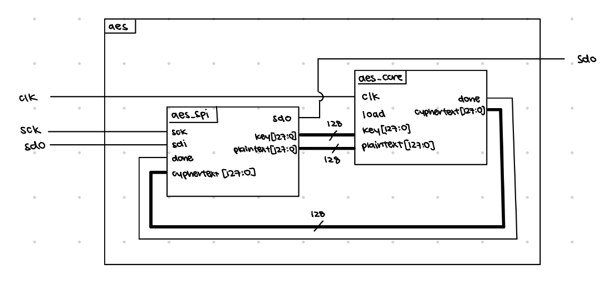
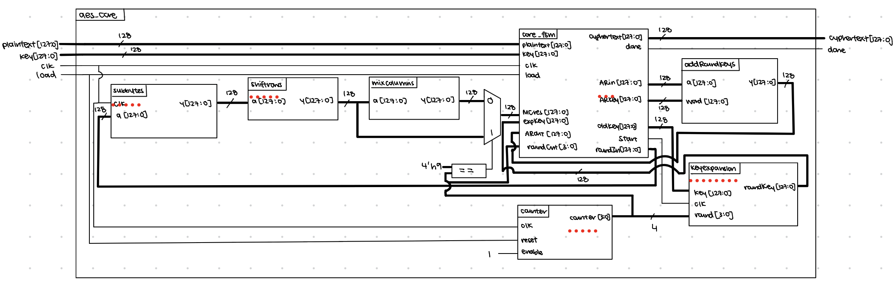
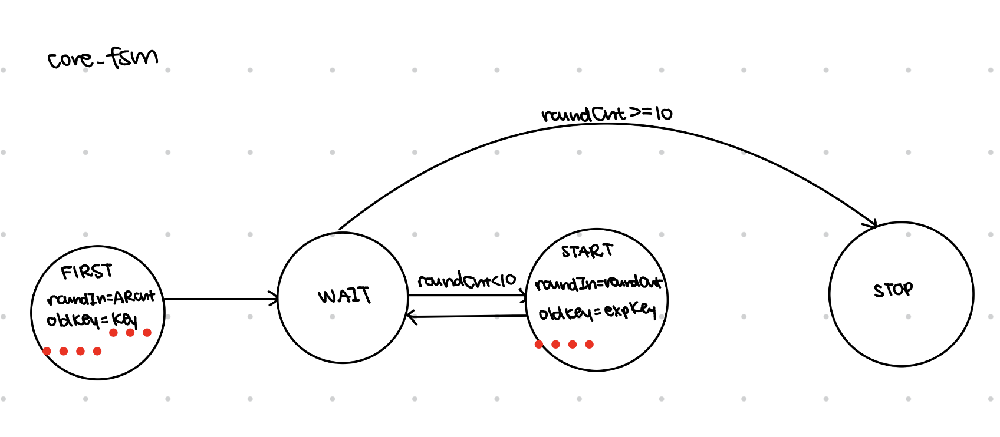
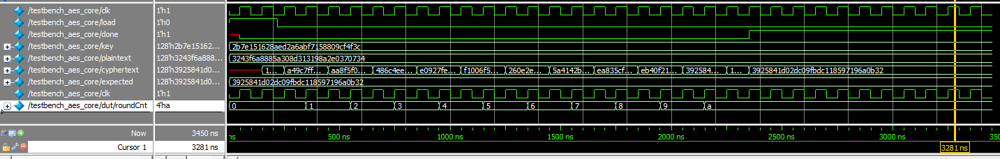
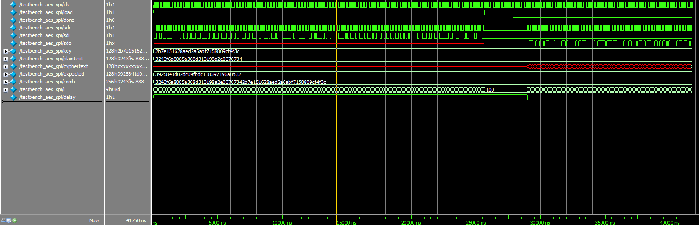
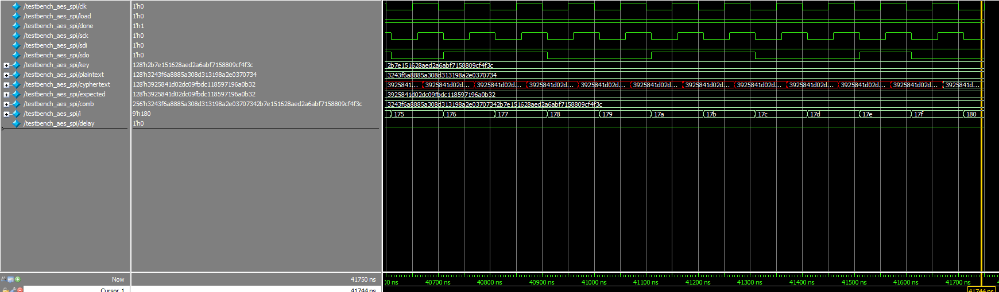

# Introduction
In this lab, the FPGA was programmed to encrypt a 128 bit text given a 128 bit key using AES, and then this was transmitted to the MCU through SPI between the boards.  

# Design and Testing Methodology
There are four primary submodules in AES: subbytes, shift rows, mix columns, and add round keys. Shift rows, mix columns, and add round keys were written entirely combinationally, and subbytes was sequential. 

Subbytes was written using 16 instances of sbox, which finds the corresponding result of a 1 byte input on the look up table. Subbytes was triggered on clock because then the look up table becomes a block of ROM, which reduces the amount of hardware necessary, or else the large lookup table would be implemented on logic elements, which is much more costly.

Another module was written for key expansion, which feeds in the key that is used for add round keys. A FSM was used for keyexpansion, because the new key generated for each round of the encryption depended on the key from the last round, so we needed two instances of keys, the old one and the current one. Every time the round incremented, the old key would take the value of the current key, and the current key would be calculated using the new old key.

To minimize hardware instantiation, the four primary submodules were each only instantiated once, and then chained together. Since only subbytes is sequential, the round would increment every clock tick until the tenth round has completed.

# Technical Documentation

::: {.callout-note collapse="true"}
## Top level block diagram

:::
::: {.callout-note collapse="true"}
## AES core block diagram

:::

::: {.callout-note collapse="true"}
## FSM

:::

::: {.callout-note collapse="true"}
## AES Core waveform results

:::

::: {.callout-note collapse="true"}
## AES SPI waveform results

:::

# Results and Discussion
I spent roughly 19 or 20 hours working on this lab. My design works in simulation. It passes the aes core testbench as well as the aes spi testbench. Initially, I tried a different implementation, which primarily used sbox instead of sbox sync for key expansion and subbytes. The approach was to have only one look up table for sbox in hardware, and stall however many times necessary for all bytes that use sbox for that operation. I ran into a lot of syntax issues, so I ended up using sbox sync which has the look up table in ROM. 

# AI Prototype
For the AI prototype, I used Gemini. The output from the prompt where the entire encryption standard was provided was very concise and clean, and did each step of key expansion clearly. On the other hand, the output from the prompt where only the pseudocode was provided used much weirder syntax. Everything was in a generate loop or in a function and used awkward indexing that more closely followed the pseudocode. The latter was able to recognize that the pseudocode came from AES and implemented the Rcon table without being asked for it. 